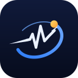

<!-- TODO before submitting: add the demo video link under "Live app" (f3). -->

<p align="center"></p>

# AstroPulse

*Normal, for you.* Brand files and rules: [`docs/brand/`](docs/brand/).

**NASA Space Apps Challenge 2026, Cairo — Team Space Monkeys 🚀**

Challenge: [Create Health Monitoring Software for Astronauts on Space Missions](https://www.spaceappschallenge.org/2026/challenges/health-monitoring-software/)

**Live app:** https://space-monkeys-2026.azurewebsites.net

---

## The problem

On a long mission, an astronaut carries most of the responsibility for noticing their own health problems before they become serious — and a message to Earth can take anywhere from about a second (ISS) to 20 minutes (Mars). Fixed "normal ranges" also don't hold up well in space: gravity, isolation, radiation, and a sealed environment change what's normal for a given person over time.

## What we built

AstroPulse is a single web app with two views:

- **Crew view** — your phone's camera reads your pulse live (a fingertip on the lens), or an on-screen simulator sends sample readings; blood pressure, blood sugar, sleep and mood are logged by hand. Every reading is colored green/yellow/red against sourced thresholds, shown on a dashboard, a clickable interactive body, and a decision screen that tells the astronaut what to do and how long a reply from Earth will take.
- **Ground control view** — the flight surgeon's screen, showing reports as they arrive after that same communication delay.

Underneath, a model learns each astronaut's own baseline from their first week of readings and flags a real, sustained drift days before the fixed color thresholds would — even while the screen still reads green. When it flags something, the app explains which of NASA's five spaceflight hazards is responsible, in plain language, and forecasts how many days until that metric would turn red if the trend continues.

### The three-moment demo

1. **A finger on the phone camera** — the pulse appears live, the matching body part lights up by color.
2. **Day 143, en route to Mars** — a two-week mock scenario plays: sleep drops, resting heart rate creeps up, the color is still green, and the model says *this isn't your normal, and it's isolation* — with a forecast for when it'll turn red.
3. **Status turns red** — the app shows how long Earth's reply will take, and the ground control screen receives the report after that delay.

### Beyond the three moments

- **Evidence tab** — a Monte Carlo "virtual crew trial" (`ai/trial.py`, hypotheses written before the first run) that compares a personal baseline with fixed color thresholds. We report what held and what didn't, including a failed hypothesis and the finding that our first model false-alarms under realistic noise.
- **Guided steps** — for a yellow or red indicator: what to do now, a timer, measure again (camera or typed), then a decision (back in range / closer / not better) and, if needed, a report to Earth that says what was tried. Inspired by NASA's work on autonomous crew medical support; decision support, not medical advice.
- **Your data tab** — drop a CSV of your own daily resting heart rate (and sleep) from a watch or health app and see *your* normal next to the fixed ranges. It stays in your browser.
- **Replay tab** — the Day-143 scenario day by day: what the fixed color ranges said next to what the personal baseline said (and an honest note where the colors were first).
- **Crew tab** — a simulated crew of four: is a drift personal (one person) or environmental (everyone at once, with cabin CO₂)?
- **AstroPulse Index** — one 0–100 number for how far you are from your *own* normal.
- **Space weather** — live NOAA radiation/solar-storm data for the hazard no vital sign shows.
- **Phone-camera pulse** — put a fingertip on the phone camera for a real, approximate heart rate and HRV.
- **Checks tab** — a reaction test and a near-vision check, compared only with your own earlier runs.
- **Two-way delay** — the flight surgeon's reply crosses the same signal delay back to the crew.
- **"How sure are we?" badges** — every indicator says whether its ranges and its space-hazard link are strong, approximate, disputed, or our own inference.
- **Works when the link drops** — installable, offline outbox for readings, read-aloud advice, privacy choices (a red alert is always sent), and a printable summary for the doctor.

## Try it

Open the live link above — no install needed, works on a phone or laptop:

1. On a phone, press **Measure my pulse with the phone camera** (top of the page): cover the camera lens and flash with a fingertip for 25 seconds and the browser reads your real heart rate (and a rough HRV) from the light through your skin, then press **Send as my heart rate**. It is an experiment with approximate accuracy, not a medical measurement, and it needs camera permission on https or localhost. On a laptop or without a camera, press **Simulate readings** to start live sample readings.
2. Open **Body** to see the interactive body update live, by color.
3. Open the **Log a check** tab to enter blood pressure, blood sugar, sleep, or mood.
4. Click any metric card on the Status tab to expand its chart; when the model has flagged that metric, you'll also see why, what to do, and a forecast.
5. Open `#ground` (linked in the footer) in a second tab for the ground-control (flight surgeon) view.

### Advice language and resetting the demo

Color advice is in English by default (`GET /api/status`); add `&lang=ar` for the original Arabic. Because the public link has one shared crew member, **Restore demo data** (Ground control view, `#ground`, or `POST /api/demo/restore`) removes anything added during the demo (camera/simulated/manual readings, reports, replies) and keeps the Day-143 sample data.

### Run it locally

```bash
cd web && npm install && npm run build   # builds the screens into api/wwwroot
cd ../api && dotnet run                  # http://localhost:5080
```

Deployment steps (Azure) are in [`api/README.md`](api/README.md).

## Works when the link drops

A mission's connection comes and goes, so the app is built to keep working: it is installable (a service worker keeps the app and the last data available offline), a reading logged with no connection is saved on the device and sent automatically when the link returns, and advice can be read out loud (Web Speech API) for hands-busy moments. The service worker's logic and the offline outbox are covered by `node web/src/offline/sw.test.mjs` and `outbox.test.mjs`. Note: we could not exercise a real service-worker registration in our test browser, so test "install" and "offline" once on a real phone.

## What is real and what is simulated

| Part | Status |
|---|---|
| Color ranges | Real published ranges (AHA, CDC, MedlinePlus, NSF). The yellow bands are our design. See `research/sources.md`. |
| Space weather | **Real**, live from NOAA SWPC (a recorded real reading if NOAA can't be reached). The "solar storm" preview is simulated and labeled. |
| Phone-camera pulse | **Real measurement**, approximate accuracy. The algorithm is validated on 53 real recorded finger signals (1.1 bpm mean error on accepted readings); the camera itself still needs a real-phone check. |
| Crew readings and the Day-143 story | **Synthetic**, generated data. |
| Virtual crew trial, Crew tab | **Simulation** with assumed noise levels. Not validated on real astronauts. |
| AstroPulse Index, "person or environment" rule | **Our own** methods, not published standards. |
| SpO₂ and skin temperature | **Simulated only.** This version has no sensor hardware, and a phone camera can't measure them reliably. |

AstroPulse is a prototype and is not a medical device.

## No hardware

AstroPulse needs nothing but a phone or laptop. The one real, live measurement is the **pulse from the phone camera**; everything else is typed in (blood pressure, blood sugar, sleep, mood), taken as a quick check on screen (reaction test, near vision), read from public data (NOAA space weather), or simulated and labeled as such. An earlier plan for a finger-sensor device (ESP32 + MAX30102) was dropped; its code stays in `firmware/` for reference but is not part of this submission.

## Data

The two-week "Day 143" scenario (`data/mock/day143.json`) is **synthetic, generated data**, not from a real person — see `data/README.md` and `data/mock/generate.py`. The live app computes the anomaly model, explanations and forecast in C# (`api/Insights/`), from whatever has actually been logged. The Python version in `ai/` is the original reference implementation, kept in step by a parity test (`dotnet test`); the FastAPI wrapper in `ai/service/` is optional and is not deployed. Precomputed results (`data/precomputed/`) are the fallback if the live computation ever throws.

## Tests

```bash
# CI (.github/workflows/ci.yml) runs all of this on every pull request
cd web && npm test                      # 15 Node suites: detector parity, camera pulse, Index, crew rule, replay, CSV import, guided steps, offline, privacy...
cd tests/SpaceApi.Tests && dotnet test  # 29 C# tests: live model vs the Python model, NASA DONKI parsing, and the whole API run in memory
python ai/trial.py                      # re-runs the virtual crew trial (writes data/trial/results.json)
node scripts/preflight.mjs <url>          # checks a running copy (local or the live link) the way a judge meets it
```

## Sources

Full detail, with every link and an honest note on which ones are stronger than others, is in [`research/sources.md`](research/sources.md) (color thresholds) and [`research/explanations.json`](research/explanations.json) (space-hazard explanations, sourced from NASA). In short:

- **Color thresholds** — American Heart Association (heart rate, blood pressure), MedlinePlus/NIH (oxygen saturation), CDC (blood sugar, sleep). Skin temperature has no precise clinical source and is an approximation; mood is a self-reported 1–5 scale with no clinical standard, included because NASA's Human Research Program tracks it as a leading indicator of isolation.
- **Space-hazard explanations** — NASA (cardiovascular health in microgravity, cabin air quality, sleep in orbit, behavioral health and isolation). The blood-sugar/isolation link is our own inference from NASA's nutrition research, not a direct NASA statement — flagged as our weakest source.
- **Space weather (radiation)** — live from NOAA's Space Weather Prediction Center (`services.swpc.noaa.gov`: NOAA scales, GOES proton flux, Kp, solar wind), read by `GET /api/space-weather`. If NOAA can't be reached the app serves a recorded real reading and labels it. The "simulated solar storm" preview is labeled as simulated.
- **Real-recording validation** — the camera-pulse algorithm is checked against 53 recordings of the public BIDMC PPG and Respiration Dataset (PhysioNet, Open Data Commons Attribution License): 1.1 bpm mean error on accepted readings. Reproduce with the "Validate pulse algorithm" GitHub workflow.
- **Recent solar events** — NASA DONKI (flares, solar particle events, geomagnetic storms) on the space-weather card.
- **Outside evidence for personal baselines** — Mishra et al., "Pre-symptomatic detection of COVID-19 from smartwatch data", Nature Biomedical Engineering, 2020.
- **Method inspiration** — NASA's Integrated Medical Model (a Monte Carlo risk simulation), NASA HRP's open question on meaningful thresholds and crew self-monitoring, Mars-500 findings that individuals respond very differently to isolation, and NASA's CO₂ technical brief. Full list in [`docs/winning-plan.md`](docs/winning-plan.md).
- **Challenge background** — NASA's own [challenge page](https://www.spaceappschallenge.org/2026/challenges/health-monitoring-software/) and its Resources tab (five hazards of human spaceflight, risks of human spaceflight).

## AI usage

We used Claude Code throughout the build: scaffolding the API and the screens; implementing readings storage, validation, SignalR live updates, and the ground-control report flow; researching and sourcing the color thresholds and space-hazard explanations from NASA, CDC, AHA, and MedlinePlus when the team member who owned that research was unavailable; building the baseline/anomaly-detection model, its FastAPI wrapper, and the trend-forecast model; generating the synthetic two-week mock dataset; and, in the final stretch, the virtual crew trial, the phone-camera pulse, the space-weather feed, the AstroPulse Index, the crew and checks screens, the offline support, the English advice texts, the integration tests and CI. Every use is logged, with who requested it and what it covered, in [`docs/ai-usage.md`](docs/ai-usage.md).

## Team

| Name | Role |
|---|---|
| Shahd Ashraf | Team lead, AI |
| Mohamed | AI |
| Abdelrahman | Full-stack, task planning |
| Shahd | Full-stack |
| Ammar | Video and delivery (the hardware track was dropped) |
| Nada | Research |

## Repo map

| Folder | What's in it |
|---|---|
| `api/` | ASP.NET Core server: readings, colors, live updates (SignalR), reports, AI result endpoints |
| `web/` | React + Vite screens |
| `ai/` | Baseline/anomaly model, cause explanations, trend forecast, and the FastAPI service wrapping them |
| `firmware/` | Dropped hardware plan (reference only, not part of the submission) |
| `tests/` | C# tests (xUnit), including live model vs Python parity |
| `research/` | Sourced color thresholds and space-hazard explanations |
| `data/` | The Day 143 mock scenario, precomputed AI fallback results, and the virtual crew trial results |
| `contracts/` | The shared data/API shapes every part of the app follows |
| `docs/` | Decisions, workflow, the winning plan, and this AI-usage log |
| `docs/pitch/` | Video script, backup slides, judge Q&A, submission text, demo-day checklist |
